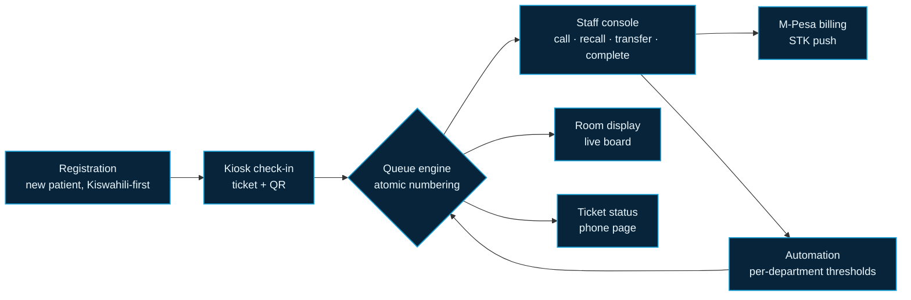
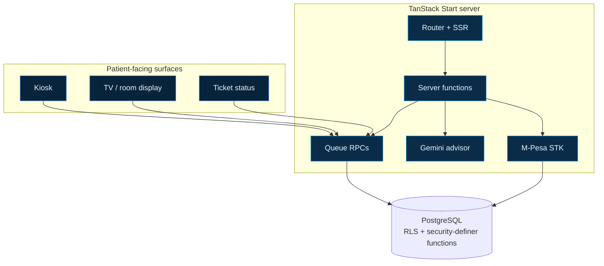

<div align="center">
  
</div>

<div align="center">
  
</div>

<h1 align="center">KIJABE CARE FLOW</h1>

<p align="center">
  <strong>Outpatient queue intelligence for AIC Kijabe Hospital.</strong><br/>
  Registration, kiosk check-in, staff console and room displays —<br/>
  one live queue, from the front door to the pharmacy window.
</p>

<p align="center">
  <a href="#the-flow"></a>
  <a href="#the-stack"></a>
  
  
  
  
</p>

<p align="center">
  <em>“Health Care to God’s Glory.”</em>
</p>

**[The flow](#the-flow)** · **[Built for the floor](#built-for-the-floor-not-the-demo)** · **[The stack](#the-stack)** · **[Quick start](#quick-start)** · **[Design language](#design-language)** · **[Privacy](#privacy-posture)** · **[Deploy](#deploy)**


## The flow

> **One ticket. Every desk. No one asking “where next?”**
>
> A patient should never have to ask where to go next. Care Flow answers that with a single ticket that travels the hospital faster than the patient does.



*Every state change is a database function with an audit row underneath it — the neon is the interface, the trail is the truth.*


## Built for the floor, not the demo

| Lane | What the user sees | Guardrail underneath |
| :--- | :--- | :--- |
| **Registration** | A calm, bilingual intake that leads with Kiswahili for new patients | Registrar-scoped access; nothing queues until registration lands |
| **Kiosk** | One tap issues a ticket with a phone-scannable QR | Anonymous by design, RPC-only, no direct table reads |
| **Queue engine** | Fair, atomic ticket numbers per department | Postgres security-definer functions; numbering and calling cannot race |
| **Staff console** | Call, recall, transfer, complete — with the next patient always one key away | A staff or admin role row is required; a login alone grants nothing |
| **Billing** | M-Pesa STK push from the consult desk | Initiated server-side; callbacks reconcile payment state |
| **Displays** | A live room board that reads from across the ward | Polls a status endpoint; no patient identifiers on screen |
| **Ticket status** | Patients track their own ticket from a phone | RPC-only; phone numbers stay hidden from the public |
| **Automation** | Departments tune their own wait thresholds | Bounded validation, admin-only writes, simulation mirrors the DB checks |

### The audit rule

> `ticket_events` is **append-only**: staff can read it, never rewrite it, and it must never hold patient identifiers. Compliance is a schema decision, not a policy PDF.

### The nightly archive

At **00:00 Africa/Nairobi** the server exports every finished visit from previous days (`done`, `no_show`, `closed`) together with its payments to **Superadmin → Patients & export → Nightly archive**, then deletes those rows. Waiting, called, in-room and pending-payment tickets are never touched. The export is written in the same transaction before the delete, and a free Render instance that was asleep at midnight catches up on the first request after it wakes.


## The stack



- **TanStack Start + React 19** — full-stack routing, SSR and server functions in one tree.
- **TypeScript, strict** — `noUncheckedIndexedAccess` and `exactOptionalPropertyTypes` are on.
- **PostgreSQL** with row-level security; queue transitions live in SQL functions, not in the client.
- **Tailwind CSS 4** with a Kijabe palette (`#159ed5`, `#0c729c`, `#60a5fa`, `#102a43`).
- **PWA** — installable kiosk and display shells.
- **Gemini** — server-side queue advisor; keys never reach the browser.
- **M-Pesa Daraja** — STK push and callback reconciliation.
- **WebAuthn** — biometric work-ID sign-in for staff.


## Quick start

```sh
git clone https://github.com/Luffy254-cyber-spec/KijabeHospitalQueue.git
cd KijabeHospitalQueue
npm install
cp .env.example .env        # then fill in the values below
npm run db:bootstrap        # create schema, roles and helper functions
npm run dev                 # http://localhost:8080
```

> Use `npm run dev -- --port 8081` if you prefer the kiosk port used on the LAN.

### Environment

<details open>
<summary><strong>Environment variables</strong> — click to collapse</summary>

| Variable | Purpose | Notes |
| :--- | :--- | :--- |
| `DATABASE_URL` | PostgreSQL connection string | Local `kijabe_care_flow` database by default |
| `AUTH_SECRET` | Signs local staff session tokens | Replace the development value before deploying |
| `GEMINI_API_KEY` | Queue advisor + announcements | Server-only; never expose to the client |
| `MPESA_ENV` | `sandbox` or `production` | Selects the Daraja host |
| `MPESA_SHORTCODE` | Paybill / till number | — |
| `MPESA_PASSKEY` | Lipa na M-Pesa passkey | Must match the chosen environment and shortcode |
| `MPESA_CONSUMER_KEY` / `MPESA_CONSUMER_SECRET` | Daraja app credentials | Sandbox and production keys differ |
| `MPESA_CALLBACK_URL` | Public HTTPS endpoint | Must end in `/api/mpesa/callback` |
| `VITE_PUBLIC_APP_URL` | Origin encoded into ticket QR codes | LAN IP for kiosks, public domain when hosted |
| `PUBLIC_APP_URL` | Origin used in staff verification emails | Must be a host Firebase allows |

</details>

> Secrets belong in `.env` (ignored by git) or in your host’s environment settings — **never in a commit**.

### Useful scripts

| Command | Does |
| :--- | :--- |
| `npm run dev` | Vite dev server |
| `npm run build` | Production build (Nitro output) |
| `npm run preview` | Preview the built server |
| `npm run lint` | ESLint |
| `npm run test` | Vitest |
| `npm run db:bootstrap` | Local database bootstrap |


## Design language

> **The neon is the interface. The trail is the truth.**
>
> The interface borrows the hospital’s own identity — the cross-and-continent mark, the deep `#102a43` navy, the `#159ed5` cyan — and pushes it forward: neon ECG traces, glassy ticket cards, a live board that feels closer to a mission-control wall than a waiting-room sign.

Small details matter here:

- The landing page carries the hospital’s floating **Feedback** and **Email** pills, with the same gradient, expansion and easing as [kijabehospital.or.ke](https://kijabehospital.or.ke).
- Footer social links idle in a single uniform navy and only ignite to their brand color on hover, with a sticky zoom and a one-shot 3D flip.
- Motion is decorative, never load-bearing: everything degrades under `prefers-reduced-motion`.


## Privacy posture

- Public surfaces (kiosk, display, ticket status) speak only through RPCs and never expose phone numbers or patient identifiers.
- Staff actions require a role row; open sign-up grants nothing.
- AI prompts and API keys live server-side, behind staff authentication.
- Every queue transition writes an audit event; the audit trail holds no patient details.


## Deploy

`render.yaml` provisions the Node web service. The database lives on [Neon](https://neon.tech) free Postgres, because Render's free PostgreSQL expires 30 days after creation.

<details open>
<summary><strong>Render — dashboard walkthrough</strong></summary>

1. **Neon:** create a project in an EU region, then copy the **pooled** connection string (the host contains `-pooler`) — Render cannot reach Neon's IPv6-only direct host. It already ends in `?sslmode=require`.
2. **Provision the schema once**, from the repo on your machine:
   ```sh
   DATABASE_URL="postgresql://…-pooler….neon.tech/neondb?sslmode=require" npm run db:bootstrap
   ```
   This creates the `auth` shim, applies every migration, and seeds `admin@kijabe.local` / `admin1234`. Change that password after signing in.
3. Render → **New → Blueprint**, connect `Luffy254-cyber-spec/KijabeHospitalQueue`, and apply. The build runs `npm ci && npm run build`; Nitro emits a Node server and `npm start` boots `.output/server/index.mjs` on Render's `PORT`.
4. Fill the values marked `sync: false`: `DATABASE_URL` (the Neon pooled URL), `GEMINI_API_KEY`, the M-Pesa credentials, `MPESA_CALLBACK_URL`, `VITE_PUBLIC_APP_URL` and `PUBLIC_APP_URL` (use `https://kijabe-careflow-queue.onrender.com`).
5. Redeploy after the first successful boot so ticket QRs pick up the final public URL.

</details>

> **Free tier reality check:** Free instance types do not support pre-deploy commands, which is why step 2 runs from your machine; re-run it after pulling new migrations. Free web services also sleep after 15 minutes idle — keep the kiosk awake with a free uptime pinger, or move to the Starter instance for production.

> `VITE_PUBLIC_APP_URL` is baked in at build time — set it before the first deploy so ticket QR codes point at the public domain. Ticket QRs resolve at runtime through `/api/public/app-origin`: a public deployment always returns its own origin (or the public `VITE_PUBLIC_APP_URL`), never a LAN address, so a phone on mobile data can scan a printed ticket and land on `https://<your-domain>/ticket/<id>`.

### Environment variables for hosting

| Variable | Production value |
| :--- | :--- |
| `DATABASE_URL` | Neon **pooled** PostgreSQL URL (`?sslmode=require`) |
| `AUTH_SECRET` | Long random string, different from development |
| `GEMINI_API_KEY` | Gemini key for advisors and announcements |
| `MPESA_ENV` | `production` for paybill 512900 |
| `MPESA_SHORTCODE` | `512900` |
| `MPESA_PASSKEY` | Production passkey for that shortcode |
| `MPESA_CONSUMER_KEY` / `MPESA_CONSUMER_SECRET` | Daraja **production** app credentials |
| `MPESA_CALLBACK_URL` | `https://<your-domain>/api/mpesa/callback` |
| `VITE_PUBLIC_APP_URL` | `https://<your-domain>` |
| `PUBLIC_APP_URL` | `https://<your-domain>` |

<details>
<summary><strong>Finishing M-Pesa for production</strong> — 5 steps</summary>

1. Open the Daraja portal and confirm the app is a **production** app (sandbox keys are rejected by `api.safaricom.co.ke`).
2. Copy the **Lipa na M-Pesa Online passkey** shown for shortcode `512900` — the sandbox test passkey will not authenticate a live paybill.
3. Set `MPESA_ENV=production`, the shortcode, the production passkey, and the production consumer key/secret.
4. Set `MPESA_CALLBACK_URL` to the deployed domain. It must be public HTTPS and end in `/api/mpesa/callback`; Safaricom will not post to localhost. For local testing, expose the dev server through a tunnel and temporarily use that URL.
5. Pay a small amount through the staff console, then confirm the ticket shows a receipt and `payments` reconciles via the callback.

</details>

<details>
<summary><strong>Firebase Hosting &amp; database notes</strong></summary>

**Firebase Hosting.** `kijabeoutflow.firebaseapp.com` is Firebase’s default domain, not a Node runtime — it cannot serve SSR routes or `/api/mpesa/callback` by itself. Use Cloud Functions/Cloud Run for the server, or point M-Pesa at the Render deployment.

**Database.** Either host needs a reachable PostgreSQL instance; `localhost` is not reachable from the cloud. Run `npm run db:bootstrap` against the hosted database, and confirm the `pg_cron` automation job is available (or drive `run_queue_automation()` from the display poller, which already wakes it).

</details>


## License

MIT — see [LICENSE](./LICENSE).

<div align="center">
  <sub><strong>AIC Kijabe Hospital</strong> · Kijabe, Kiambu County, Kenya</sub><br/>
  <sub><em>Care Flow</em> — the queue moves like a pulse.</sub>
</div>
