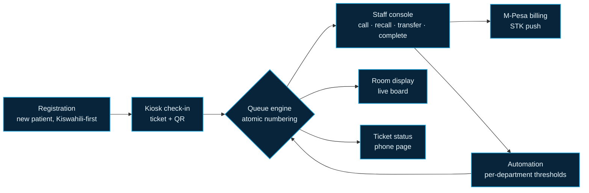
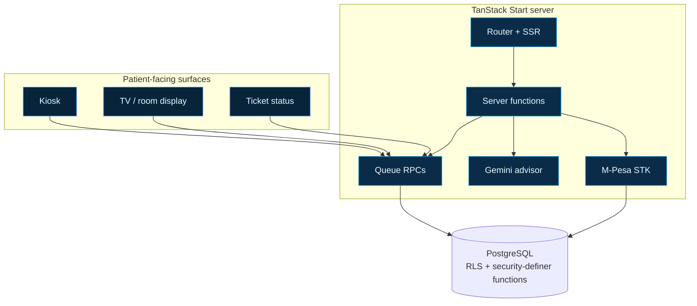
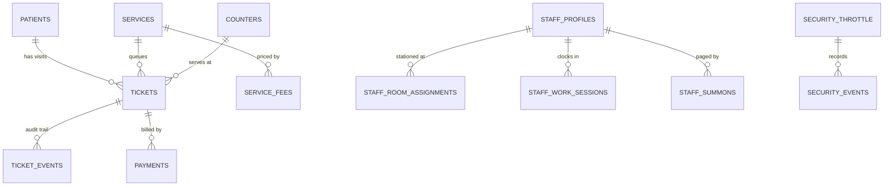

<div align="center">
  
</div>

<div align="center">
  
</div>

<h1 align="center">KIJABE CARE FLOW</h1>

<p align="center">
  <strong>Outpatient queue intelligence for AIC Kijabe Hospital.</strong><br/>
  Registration, kiosk check-in, staff console and room displays —<br/>
  one live queue, from the front door to the pharmacy window.
</p>

<p align="center">
  <a href="#the-flow"></a>
  <a href="#the-stack"></a>
  
  
  
  
</p>

<p align="center">
  <em>“Health Care to God’s Glory.”</em>
</p>

**[The flow](#the-flow)** · **[Built for the floor](#built-for-the-floor-not-the-demo)** · **[The stack](#the-stack)** · **[Inside the engine](#inside-the-engine)** · **[Surfaces](#the-surfaces)** · **[Quick start](#quick-start)** · **[Design language](#design-language)** · **[Privacy](#privacy-posture)** · **[Security](#security-in-depth)** · **[Deploy](#deploy)** · **[Troubleshooting](#troubleshooting)**


## The flow

> **One ticket. Every desk. No one asking “where next?”**
>
> A patient should never have to ask where to go next. Care Flow answers that with a single ticket that travels the hospital faster than the patient does.



*Every state change is a database function with an audit row underneath it — the neon is the interface, the trail is the truth.*



*One token, five stages. The animation is decoration; the ticket is the contract.*


## Built for the floor, not the demo

| Lane | What the user sees | Guardrail underneath |
| :--- | :--- | :--- |
| **Registration** | A calm, bilingual intake that leads with Kiswahili for new patients | Registrar-scoped access; nothing queues until registration lands |
| **Kiosk** | One tap issues a ticket with a phone-scannable QR | Anonymous by design, RPC-only, no direct table reads |
| **Queue engine** | Fair, atomic ticket numbers per department | Postgres security-definer functions; numbering and calling cannot race |
| **Staff console** | Call, recall, transfer, complete — with the next patient always one key away | A staff or admin role row is required; a login alone grants nothing |
| **Billing** | M-Pesa STK push from the consult desk | Initiated server-side; callbacks reconcile payment state |
| **Displays** | A live room board that reads from across the ward | Polls a status endpoint; no patient identifiers on screen |
| **Ticket status** | Patients track their own ticket from a phone | RPC-only; phone numbers stay hidden from the public |
| **Automation** | Departments tune their own wait thresholds | Bounded validation, admin-only writes, simulation mirrors the DB checks |

### Waiting-room ambience

- One soft instrumental bed plays at **20% volume** on every page, tab and browser. The song and its position come from a wall-clock slot (15 minutes, from a fixed UTC epoch), so any screen that joins lands on the same track at the same second — no echo, no drift — and the playlist advances and loops on its own.
- The round player can be **paused** at any time. While a screen is open it also **resumes by itself** after the tab, the browser or the host wakes up, returning to the slot the rest of the ward is already on.
- Every open screen sends a **10-minute heartbeat** to its own origin, so a free Render instance is never allowed to idle out; the next patient gets a warm server instead of a cold start.
- The floating **Email us** pill and the music player share a corner but never overlap: the player stacks above the pill.

### The audit rule

> `ticket_events` is **append-only**: staff can read it, never rewrite it, and it must never hold patient identifiers. Compliance is a schema decision, not a policy PDF.

### The nightly archive

At **00:00 Africa/Nairobi** the server exports every finished visit from previous days (`done`, `no_show`, `closed`) together with its payments to **Superadmin → Patients & export → Nightly archive**, then deletes those rows. Waiting, called, in-room and pending-payment tickets are never touched. The export is written in the same transaction before the delete, and a free Render instance that was asleep at midnight catches up on the first request after it wakes.

### A ticket's life



| State | Arrives from | What it means on the floor |
| :--- | :--- | :--- |
| `waiting` | registration, kiosk, transfer, no-show re-queue | In a department queue, ordered by priority and then arrival time |
| `called` | `call_next` or `call_ticket` | Stamped `called_at`, chime plays twice, the token is read twice, the board flashes it |
| `serving` | a staff action at the desk | The patient is in the room; a counter and clinician are attached |
| `done` | a staff action | Leaves the queue and becomes eligible for the nightly export |
| `no_show` | a staff action after a recall | Recorded honestly; staff can re-queue it or close it |
| `closed` | automation, day close, nightly archive | Terminal state — the visit is finished |

Nothing is ever edited in place. Each move inserts a `ticket_events` row, which is why the staff console can show a history and the auditor can replay a day.


## The stack



- **TanStack Start + React 19** — full-stack routing, SSR and server functions in one tree.
- **TypeScript, strict** — `noUncheckedIndexedAccess` and `exactOptionalPropertyTypes` are on.
- **PostgreSQL** with row-level security; queue transitions live in SQL functions, not in the client.
- **Tailwind CSS 4** with a Kijabe palette (`#159ed5`, `#0c729c`, `#60a5fa`, `#102a43`).
- **PWA** — installable kiosk and display shells.
- **Gemini** — server-side queue advisor; keys never reach the browser.
- **M-Pesa Daraja** — STK push and callback reconciliation.
- **WebAuthn** — biometric work-ID sign-in for staff.

### Inside the engine



**Numbering cannot race.** `issue_ticket` reads and increments `daily_sequences` inside a security-definer function, so three screens asking at the same instant receive 041, 042 and 043 — never the same token twice, and never a silent gap. The number is per department per day, so a quiet clinic still starts at a small, readable token.

**Fairness is a sort, not a promise.** A department's queue orders by priority first, then arrival. Triage colour is staff-side information; the public board stays neutral so nobody is alarmed by a red tile in the waiting room.

**The verbs the floor actually calls**

| Verb | Called by | Effect |
| :--- | :--- | :--- |
| `register_patient` / `issue_visit` | registration desk | Creates the patient record and the visit |
| `queue_at_registration` / `queue_at_triage` | registration, triage | Places the visit in a department queue |
| `issue_ticket` | kiosk | Allocates the next atomic token |
| `call_next` / `call_ticket` | staff console | Moves the next patient, or a chosen one, to `called` |
| `staff_action` | staff console | Recall, transfer, serve, complete, no-show |
| `get_counter_queue` | staff console | The desk's own list, with the next patient always at the top |
| `get_display_board` | TV / room display | Rooms, called tokens and waiting counts — no identifiers |
| `get_ticket_status` / `get_patient_track` | phone pages | A patient's own ticket and visit progress |
| `admin_observe_queue` / `admin_ops_board` | superadmin | Cross-department observation and daily stats |

**Automation is bounded.** Each department owns a surge threshold; when the waiting count crosses it, `run_queue_automation` takes the configured action and writes an event. Every value is validated in SQL as well as in the UI, and a simulation mode lets an admin preview a threshold before saving it.

**Why the big board can be trusted.** The display reads `get_display_board`, which returns only what belongs on a wall — tokens, room names, departments, counts. No names, no phone numbers, no clinical notes. If a screen is photographed, nothing private is in the frame.

### The data model



| Table | Holds | Notes |
| :--- | :--- | :--- |
| `patients` | One row per person | Contact details stay server-side |
| `tickets` | One row per visit | Token, status, department, priority, timestamps |
| `ticket_events` | Append-only history | An event per transition; no patient details |
| `services` | Departments | Queue label, prefix, surge threshold |
| `counters` | Rooms and desks | Room name, service, active flag |
| `daily_sequences` | Token counters | Incremented atomically per department per day |
| `payments` | M-Pesa requests and receipts | `pending`, `paid`, `failed`, `cancelled` |
| `service_fees` | Price list per service | Editable by admin only |
| `insurance_providers` | Scheme list | Used by billing and registration |
| `staff_profiles` | Staff identity and status | Approved, pending, suspended |
| `staff_room_assignments` | Who is stationed where | Drives room occupancy |
| `staff_work_sessions` | Check-in and check-out | Feeds the attendance timesheet |
| `staff_summons` | Pages sent to a desk | Acknowledged by the staff member |
| `staff_webauthn_credentials` | Passkeys per staff member | Public keys only |
| `automation_settings` / `automation_state` | Thresholds and last runs | Validated in SQL |
| `security_throttle` / `security_events` | Rate-limit buckets and hits | DB-backed, survives restarts |
| `data_exports` | Nightly archive manifests | Written before deletion |


## The surfaces

| Route | Who opens it | What it is for |
| :--- | :--- | :--- |
| `/` | Everyone | Landing page: what the queue is, install prompt, support pills |
| `/staff` → Registration | Registration desk | New and returning patients, Kiswahili-first intake |
| `/kiosk` | Patients, unattended | One-tap check-in that prints or shows a ticket with a QR |
| `/staff` | Nurses, clinicians, cashiers | Role-aware console: call, recall, serve, transfer, complete, bill |
| `/display` | Waiting room TV | The public board: now serving, waiting pairs, recently called |
| `/admin` | Superadmin | Staff, rooms, services, fees, nightly archive, live observation |
| `/automation` | Admin | Per-department surge thresholds and simulation |
| `/ticket/<id>` | Patient phone | The ticket itself, with room and status |
| `/track/<patientId>` | Patient phone | Visit progress across departments |
| `/apply-db-fix` | Maintainer | A database setup reminder for self-hosting; holds no credentials |

The server API behind those screens is deliberately small:

| Endpoint | Purpose |
| :--- | :--- |
| `/api/public/queue-status` | The board's polling feed |
| `/api/public/announce` | Gemini PA voice, rate-limited and allowlisted |
| `/api/public/app-origin` | Origin resolver for ticket QRs, also the heartbeat target |
| `/api/local/auth` | Sign-in, codes, reset, email change |
| `/api/local/rpc` / `/api/local/query` | Authenticated RPC bridge (allowlisted) |
| `/api/mpesa/stkpush` | Starts an STK push |
| `/api/mpesa/status` | Polls a payment |
| `/api/mpesa/callback` | Safaricom callback, shared-secret gated |


## Quick start

```sh
git clone https://github.com/Luffy254-cyber-spec/KijabeHospitalQueue.git
cd KijabeHospitalQueue
npm install
cp .env.example .env        # then fill in the values below
npm run db:bootstrap        # create schema, roles and helper functions
npm run dev                 # http://localhost:8080
```

> Use `npm run dev -- --port 8081` if you prefer the kiosk port used on the LAN.

### Environment

<details open>
<summary><strong>Environment variables</strong> — click to collapse</summary>

| Variable | Purpose | Notes |
| :--- | :--- | :--- |
| `DATABASE_URL` | PostgreSQL connection string | Local `kijabe_care_flow` database by default |
| `AUTH_SECRET` | Signs local staff session tokens and hashes throttling subjects | At least 32 characters; the server refuses to boot with a shorter value in production |
| `MPESA_CALLBACK_SECRET` | Shared token appended to the Daraja callback URL | Added automatically as `?token=…`; callbacks that do not carry it are rejected |
| `TURNSTILE_SITE_KEY` / `TURNSTILE_SECRET_KEY` | Cloudflare Turnstile widget and server check | Optional — leave both blank to hide the widget and skip verification |
| `GEMINI_API_KEY` | Queue advisor + announcements | Server-only; never expose to the client |
| `MPESA_ENV` | `sandbox` or `production` | Selects the Daraja host |
| `MPESA_SHORTCODE` | Paybill / till number | — |
| `MPESA_PASSKEY` | Lipa na M-Pesa passkey | Must match the chosen environment and shortcode |
| `MPESA_CONSUMER_KEY` / `MPESA_CONSUMER_SECRET` | Daraja app credentials | Sandbox and production keys differ |
| `MPESA_CALLBACK_URL` | Public HTTPS endpoint | Must end in `/api/mpesa/callback` |
| `VITE_PUBLIC_APP_URL` | Origin encoded into ticket QR codes | LAN IP for kiosks, public domain when hosted |
| `PUBLIC_APP_URL` | Origin used in staff verification emails | Must be a host Firebase allows |
| `SMTP_HOST` / `SMTP_PORT` | **Optional** mailbox for staff mail | Leave blank — Firebase Auth sends codes and confirmations |
| `SMTP_USER` / `SMTP_PASS` | Optional relay credentials | Only needed when `SMTP_HOST` is set |
| `MAIL_FROM` | Optional sender address | Setting this together with `SMTP_HOST` replaces `noreply@<project>.firebaseapp.com` |
| `MAIL_FROM_NAME` | Sender display name when SMTP is used | Defaults to `Kijabe Care Flow` |

</details>

> Secrets belong in `.env` (ignored by git) or in your host’s environment settings — **never in a commit**.

### Useful scripts

| Command | Does |
| :--- | :--- |
| `npm run dev` | Vite dev server |
| `npm run build` | Production build (Nitro output) |
| `npm run preview` | Preview the built server |
| `npm run lint` | ESLint |
| `npm run test` | Vitest |
| `npm run db:bootstrap` | Local database bootstrap |


## Design language

> **The neon is the interface. The trail is the truth.**
>
> The interface borrows the hospital’s own identity — the cross-and-continent mark, the deep `#102a43` navy, the `#159ed5` cyan — and pushes it forward: neon ECG traces, glassy ticket cards, a live board that feels closer to a mission-control wall than a waiting-room sign.

Small details matter here:

- **Exact Kijabe Brand Palette:** Uses precise official colors (`#0c729c`, `#0a2233`, `#159ed5`, `#008080`, `#f0f7fa`) with a fluid borderless medical glass navbar featuring a subtle moving sheen animation.
- **Christian Instrumental & Worship Playlist:** Curated ambient background music featuring 24 diverse Christian instrumental and worship tracks, looping seamlessly without interruption across pages.
- **Faith-Based Cursor Trail:** Interactive cursor following animation displaying faith and healthcare symbols (`†`, `✚`, `✨`).
- **Real-Time EAT Weather & Clock:** Live Nairobi clock and weather forecast mounted across Staff, Kiosk, and Superadmin headers.
- **Gemini-Powered AI Navigators:** Dedicated collapsible blue gradient home navigator and bilingual Kiosk patient support assistant.
- The landing page carries the hospital’s floating **Feedback** and **Email** pills, with the same gradient, expansion and easing as [kijabehospital.or.ke](https://kijabehospital.or.ke).
- Footer social links idle in a single uniform navy and only ignite to their brand color on hover, with a sticky zoom and a one-shot 3D flip.
- Motion is decorative, never load-bearing: everything degrades under `prefers-reduced-motion`.

### Resilience on a cheap host

- **A screen never sleeps.** The Screen Wake Lock API keeps the TV and kiosk display awake; browsers without it fall back to a silent audio loop. No synthetic clicks are ever sent, so the staff idle sign-out still works.
- **The host never cold-starts mid-queue.** Every open screen pings `/api/public/app-origin` on a 10-minute timer, which keeps a free Render instance inside its idle window and warms the queue API for the next patient.
- **The music self-heals.** The shared player re-syncs to the current 15-minute slot after a suspended tab, a dropped connection or a host wake-up, and restarts a track that ends early instead of hammering the player.
- **The board is read-only.** If the network blinks, the last painted board stays on screen and the next poll repaints it; nothing on the wall is lost.
- **Installs like an app.** A service worker and manifest make the kiosk and display installable, and they open in their own standalone window.

### Accessibility and the waiting room

- Every surface is bilingual where it matters: English and Kiswahili sit side by side, and new-patient intake leads with Kiswahili.
- The TV board uses type and contrast sized for reading across a ward, with redundant cues — token, room and status — so colour is never the only signal.
- Announcements are spoken slowly, with the token spelled digit by digit, and the PA ducks the music rather than talking over it.
- Chimes are deliberately gentle: sine and triangle tones, soft attack, long decay, peaking well below medical-equipment alarms.
- Focus rings, keyboard paths and `aria` labels are present on every interactive control, and motion respects `prefers-reduced-motion`.


## Privacy posture

- Public surfaces (kiosk, display, ticket status) speak only through RPCs and never expose phone numbers or patient identifiers.
- Staff actions require a role row; open sign-up grants nothing.
- AI prompts and API keys live server-side, behind staff authentication.
- Every queue transition writes an audit event; the audit trail holds no patient details.

### Security in depth

| Layer | What it does |
| :--- | :--- |
| **Row-level security** | Every table is guarded; an anonymous caller can only reach the handful of functions exposed to the kiosk and the board |
| **Security-definer functions** | Queue maths, numbering and role checks run in SQL, so a modified browser cannot skip a rule |
| **Role rows, not just logins** | A verified email grants nothing until a `user_roles` row exists; `superadmin` is a separate, explicit grant |
| **Work-ID login** | Staff sign in with a hashed work ID plus password or a WebAuthn passkey; the raw ID is never stored |
| **Brute-force throttling** | DB-backed buckets per IP and per account: sign-in allows 5 attempts per 10 minutes per account, then blocks for 15 minutes |
| **Turnstile** | Optional Cloudflare challenge on public forms; skipped cleanly when the keys are absent |
| **Rate-limited PA** | `/api/public/announce` is capped per caller because the Gemini key behind it is metered |
| **Callback secret** | M-Pesa callbacks must carry the shared token or they are rejected outright |
| **Security headers** | CSP, `nosniff`, `SAMEORIGIN`, strict referrer policy, a closed permissions policy, and HSTS on HTTPS |
| **RPC allowlist** | The authenticated bridge will only call named functions — no arbitrary SQL and no table access from the client |
| **APPEND-ONLY audit** | Staff can read `ticket_events`, never rewrite it; the nightly export is taken before any deletion |
| **Secrets stay server-side** | Gemini, M-Pesa and database credentials never enter a client bundle or a commit |

> Throttle hits are recorded in `security_events`; the tables survive restarts and deploys, so a blocked attacker stays blocked.


## Deploy

`render.yaml` provisions the Node web service. The database is a managed PostgreSQL instance with a publicly reachable endpoint, because Render's own free PostgreSQL expires 30 days after creation.

<details open>
<summary><strong>Render — dashboard walkthrough</strong></summary>

1. **Database:** create a PostgreSQL instance with a reachable public endpoint (a managed provider is easiest). Copy its connection string from your provider's dashboard — it must include TLS, and hosted providers usually require SSL mode. Keep that string in a password manager; it is a secret.
2. **Provision the schema once**, from the repo on your machine:
   ```sh
   DATABASE_URL="<your-hosted-postgres-url>" npm run db:bootstrap
   ```
   This creates the `auth` shim and applies every migration, then seeds a development administrator that the script prints on completion. That account is local-only — use a different, strong password for any hosted database and never publish either value.
3. Render → **New → Blueprint**, connect the repository, and apply. The build runs `npm ci && npm run build`; Nitro emits a Node server and `npm start` boots `.output/server/index.mjs` on Render's `PORT`.
4. Fill the values marked `sync: false`: `DATABASE_URL`, `GEMINI_API_KEY`, the M-Pesa credentials, `MPESA_CALLBACK_URL`, `VITE_PUBLIC_APP_URL` and `PUBLIC_APP_URL` (use your deployed HTTPS origin).
5. Redeploy after the first successful boot so ticket QRs pick up the final public URL.

</details>

> **Free tier reality check:** Free instance types do not support pre-deploy commands, which is why step 2 runs from your machine. Apply only the **new** migrations after pulling — re-running the full bootstrap re-seeds the development administrator and should not be done against a live database. Free web services sleep after 15 minutes idle; any open screen keeps the instance warm through the built-in 10-minute heartbeat, so no external uptime pinger is required.

> `VITE_PUBLIC_APP_URL` is baked in at build time — set it before the first deploy so ticket QR codes point at the public domain. Ticket QRs resolve at runtime through `/api/public/app-origin`: a public deployment always returns its own origin (or the public `VITE_PUBLIC_APP_URL`), never a LAN address, so a phone on mobile data can scan a printed ticket and land on `https://<your-domain>/ticket/<id>`.

### Environment variables for hosting

| Variable | Production value |
| :--- | :--- |
| `DATABASE_URL` | Hosted PostgreSQL connection string (TLS required) |
| `AUTH_SECRET` | 32+ random characters, different from development — sign-in and throttling both depend on it |
| `MPESA_CALLBACK_SECRET` | Long random string; it is appended to the Daraja callback URL as `?token=…`, so keep `MPESA_CALLBACK_URL` free of a query string |
| `TURNSTILE_SITE_KEY` / `TURNSTILE_SECRET_KEY` | From the Cloudflare Turnstile widget; leave blank to keep the challenge disabled |
| `GEMINI_API_KEY` | Gemini key for advisors and announcements |
| `MPESA_ENV` | `production` |
| `MPESA_SHORTCODE` | Your production paybill / till number |
| `MPESA_PASSKEY` | Production passkey for that shortcode |
| `MPESA_CONSUMER_KEY` / `MPESA_CONSUMER_SECRET` | Daraja **production** app credentials |
| `MPESA_CALLBACK_URL` | `https://<your-domain>/api/mpesa/callback` |
| `VITE_PUBLIC_APP_URL` | `https://<your-domain>` |
| `PUBLIC_APP_URL` | `https://<your-domain>` |
| `SMTP_HOST` / `SMTP_PORT` | Leave blank — Firebase Auth sends staff mail (`465` TLS, `587` STARTTLS only if used) |
| `SMTP_USER` / `SMTP_PASS` | Only needed when `SMTP_HOST` is set |
| `MAIL_FROM` | Optional sender address on your own domain — replaces the Firebase sender |

<details>
<summary><strong>Finishing M-Pesa for production</strong> — 5 steps</summary>

1. Open the Daraja portal and confirm the app is a **production** app (sandbox keys are rejected by `api.safaricom.co.ke`).
2. Copy the **Lipa na M-Pesa Online passkey** shown for your production shortcode — the sandbox test passkey will not authenticate a live paybill.
3. Set `MPESA_ENV=production`, the shortcode, the production passkey, and the production consumer key/secret.
4. Set `MPESA_CALLBACK_URL` to the deployed domain. It must be public HTTPS and end in `/api/mpesa/callback`; Safaricom will not post to localhost. For local testing, expose the dev server through a tunnel and temporarily use that URL.
5. Pay a small amount through the staff console, then confirm the ticket shows a receipt and `payments` reconciles via the callback.

</details>

<details>
<summary><strong>Firebase Hosting &amp; database notes</strong></summary>

**Firebase Hosting.** Firebase’s default `*.firebaseapp.com` domain is static hosting, not a Node runtime — it cannot serve SSR routes or `/api/mpesa/callback` by itself. Use Cloud Functions/Cloud Run for the server, or point M-Pesa at the Render deployment.

**Database.** Either host needs a reachable PostgreSQL instance; `localhost` is not reachable from the cloud. Apply the migrations to the hosted database from your machine, and confirm the scheduled automation job is available in your provider (or drive `run_queue_automation()` from the display poller, which already wakes it).

</details>


## Troubleshooting

| Symptom | Likely cause | Fix |
| :--- | :--- | :--- |
| Sign-in refuses with “too many attempts” | The throttle bucket is still blocked | Wait out the 15-minute block; check `security_events` for the subject |
| Staff member signs in but sees an empty console | No `user_roles` row yet | Superadmin → Staff → grant the role, then approve the profile |
| Ticket numbers restart at 001 | New day in Africa/Nairobi, or the wrong service | Numbers are per department per day by design |
| Kiosk prints a LAN address in the QR | `VITE_PUBLIC_APP_URL` is missing at build time | Set it and redeploy; the value is baked into the build |
| Display shows “No rooms open yet” | No active counters for that service | Admin → Rooms → activate the room |
| Announcements fall back to a robotic voice | Gemini TTS quota is exhausted or the key is unset | The browser voice is the designed fallback; top up or wait for the daily reset |
| Sound button shows “Enable sound” after every reload | The browser blocked autoplay before a gesture | One tap enables it for the whole browser profile |
| Payments stay `pending` | The callback never reached the server | Confirm the public URL ends in `/api/mpesa/callback` and carries the secret |
| Nightly archive is empty | Nothing finished on the previous day | The panel only lists days that actually had finished visits |
| Free instance feels slow on the first request | It was asleep | Any open screen now keeps it warm; check the tab is actually open |

## FAQ

**Is a ticket the same as a patient?**
No. A patient is a person; a ticket is one visit. The same patient can hold several tickets over time, and the audit trail keeps them apart.

**Can staff see a patient's phone number on the board?**
No. The board only receives tokens, rooms, departments and counts.

**What happens if two desks call the same number?**
They cannot. Calling is a database transition guarded by the ticket's current state, so the second call lands on a ticket that is no longer waiting.

**Why is the music the same on every screen?**
Because it is derived from the clock, not stored per browser. Two screens opened minutes apart land on the same song and the same second.

**Does the music keep the server awake?**
No — audio is entirely client-side. A separate 10-minute heartbeat from any open screen does that, and it also warms the API.

**Where do exports live?**
In `data_exports` as manifests written inside the same transaction that deletes the finished rows; download them from **Superadmin → Patients & export**.


## License

MIT — see [LICENSE](./LICENSE).

<div align="center">
  <sub><strong>AIC Kijabe Hospital</strong> · Kijabe, Kiambu County, Kenya</sub><br/>
  <sub><em>Care Flow</em> — the queue moves like a pulse.</sub>
</div>
